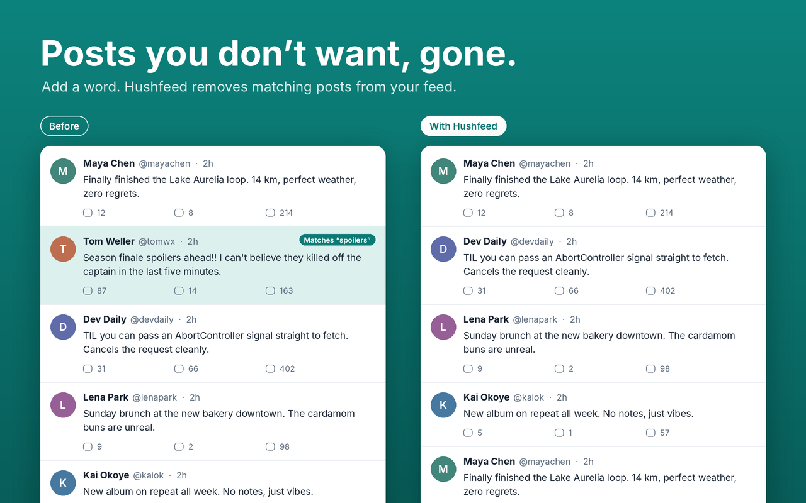

# Hushfeed

Mute posts on X (Twitter) by keyword, phrase or account. Chrome extension, Manifest V3.

[Install from the Chrome Web Store](https://chromewebstore.google.com/detail/hushfeed-%E2%80%93-mute-posts-by/bcaejbeolbmcpnjjmlmdmamjkiieacbd) · [GitHub releases](https://github.com/zngitc-bit/hushfeed/releases) · [Privacy policy](https://zngitc-bit.github.io/hushfeed/)

[](https://github.com/zngitc-bit/hushfeed/actions/workflows/package.yml)

- Whole-word, case-sensitive and regular-expression rules
- Hide posts by account, with an exceptions list
- Hide, collapse or blur matching posts
- Choose where filtering applies (home, search, profiles, replies, lists)
- Badge counter, keyboard shortcut (Alt+Shift+H), JSON export / import
- Feedback and support through email drafts you review and send
- Private: rules are stored locally, no network requests, no analytics

## Version 1.0.3

- Recognizes the updated X markup in search results and feeds, including blocked accounts and multiple posts in one list item.
- Adds **Feedback & support** in settings for problem reports and suggestions.
- Includes regression tests based on reported X page examples.

See [CHANGELOG.md](CHANGELOG.md) for the version history. A GitHub release and its Chrome Web Store approval are separate steps.



## Run it locally

1. Open `chrome://extensions` and turn on **Developer mode**.
2. Click **Load unpacked** and select the `extension/` folder.
3. After updating the local files, click **Reload** on the extension card and refresh open X tabs. Check the version shown in Hushfeed settings.

When testing the local copy, disable the store-installed copy so that only one Hushfeed instance filters the page. Each installation keeps its own settings; use Backup to export and import rules if needed.

## Repository layout

| Folder | Contents |
|---|---|
| `extension/` | The extension itself. This folder is what gets zipped and uploaded to the store. |
| `store/` | Store listing text, promo tile, screenshots, marquee |
| `docs/` | Privacy policy, published with GitHub Pages |
| `scripts/` | `build.sh` creates the store zip on macOS / Linux |
| `tests/` | End-to-end tests that run the extension in Chromium (Playwright) |
| `.github/workflows/` | Runs browser tests on pushes to main, pull requests and version tags; builds a release only after tests pass |

## Release a new version

1. Edit the code in `extension/`.
2. Raise `version` in `extension/manifest.json` and add a line to `CHANGELOG.md`.
3. Run the tests, commit and push. Create and push a tag matching the manifest version (for example `v1.0.3`).
4. GitHub Actions runs the tests and checks the tag against the manifest before building `hushfeed-1.0.3.zip` and attaching it to a GitHub Release with notes from the changelog.
5. Download the ZIP from that release and upload it to the existing extension in the Chrome Web Store dashboard.

## Run the tests

```
python -m pip install -r tests/requirements.txt
python -m playwright install chromium
python tests/e2e.py
```

On Linux, use `python -m playwright install --with-deps chromium` to install browser system dependencies as well.

The tests load the extension in Chromium and cover both the legacy X timeline markup and fixtures based on reported search and feed posts. They cannot replace a manual check on x.com after X changes its page. CI retains the test output as an artifact for troubleshooting.

## Privacy

See [docs/index.md](docs/index.md). Hushfeed reads post text on x.com only to match your rules, entirely in your browser.

## Feedback and support

Open **Settings → Feedback & support** to report a problem or suggest an improvement, or email [zng.itc@gmail.com](mailto:zng.itc@gmail.com).

The buttons open your email app with an editable draft containing the extension version and prompts. Hushfeed does not send the message automatically or attach your rules, browsing history or page content. You choose what to include and whether to send it.

## Disclaimer

Independent project, not affiliated with or endorsed by X Corp.

Copyright © 2026 ZNG. All rights reserved.
